Conteúdo: 1. Descrição do software · 2. Requisitos · 3. Casos de uso · 4. Diagrama de classes · 5. Diagramas de sequência · 6. Modelo Entidade-Relacionamento · 7. Relatório técnico · 8. Protótipo de telas · Referências.

# 1. Descrição do software

## 1.1 Visão geral

O AgroManejo é um aplicativo para celulares Android destinado a produtores rurais. Ele organiza o trabalho no campo a partir de unidades de manejo: áreas da propriedade, como talhões de lavoura e piquetes de pastagem, delimitadas por coordenadas geográficas.

Para cada unidade, o produtor desenha o contorno no mapa, indica o uso da área (lavoura, pastagem, mata ou outro) e obtém a área em hectares. Depois, planeja as atividades, com tipo, descrição, data prevista, tempo estimado, custos detalhados por item e receita esperada. Quando a atividade é executada, o produtor registra a data e os valores realizados e, ao final, avalia o resultado.

O aplicativo foi projetado para que a propriedade esteja sempre disponível no celular. Todos os dados e o mapa da região ficam armazenados no aparelho, e o produtor consulta e altera as informações mesmo sem internet. Quando há conexão, o aplicativo sincroniza tudo com um servidor central.

## 1.2 Usuários e sistemas externos

| Participante | Papel |
|---|---|
| **Produtor** | Usuário do aplicativo. Cadastra unidades de manejo e registra e avalia atividades. |
| **Sistema de Geolocalização** | GPS do celular. Informa a posição do produtor no mapa e permite capturar vértices no local. |
| **Provedor de Mapas** | Serviço que fornece as imagens de fundo do mapa, baixadas para o aparelho. |
| **Back-end Remoto** | Servidor na nuvem (Supabase/PostgreSQL). Autentica o produtor e armazena os dados sincronizados. |

## 1.3 Funcionalidades principais

1. **Cadastrar unidades de manejo** com três ou mais vértices e o uso da área. Cada vértice pode ser digitado, obtido pelo GPS ou marcado no mapa.
2. **Delimitar a área**: formar e validar o polígono e calcular sua área em hectares.
3. **Visualizar a propriedade no mapa**, com todas as unidades coloridas pelo uso, suas áreas e a posição do produtor.
4. **Planejar atividades** com os dados detalhados na seção 1.5, inclusive a data prevista.
5. **Registrar a execução** das atividades, com a data e os valores realizados.
6. **Avaliar atividades** concluídas como positivas ou negativas, com observações.
7. **Acompanhar a agenda** das atividades de todas as unidades, por data e por situação.
8. **Editar e excluir** unidades e atividades a qualquer momento.
9. **Trabalhar sem internet**, com dados e mapa da propriedade guardados no aparelho, e sincronizar automaticamente quando houver conexão.

## 1.4 Funcionamento do mapa

O mapa é a tela principal do aplicativo. Ele mostra toda a propriedade e é o ponto de partida para as demais funções.

Camadas exibidas, de baixo para cima:

1. **Imagem de fundo (satélite).** Vem de um pacote de mapa armazenado no próprio aparelho, que cobre a região da propriedade.
2. **Unidades de manejo.** Cada uma aparece como um polígono semitransparente, com cor conforme o uso (lavoura, pastagem, mata ou outro), o nome e a área em hectares. Um ícone sinaliza unidades com alterações ainda não sincronizadas ou em conflito.
3. **Vértices.** Pontos numerados na ordem do contorno, exibidos durante o desenho ou a edição de uma unidade.
4. **Posição do produtor.** Ponto atualizado continuamente enquanto o mapa está aberto, com um círculo que indica a precisão do GPS.

**Navegação:**

- Arrastar e pinçar movem e ampliam o mapa.
- O botão "Minha posição" centraliza o mapa no produtor.
- O botão "Ver propriedade" enquadra todas as unidades.
- Tocar em uma unidade abre um painel inferior com nome, uso, área, lista de atividades e as ações "Nova atividade", "Editar contorno" e "Excluir unidade".
- No topo do mapa, um indicador mostra a situação da sincronização: tudo sincronizado, *n* alterações pendentes ou *n* conflitos. Tocar no indicador abre a lista de pendências e conflitos (seção 1.6).

**Desenho e edição de uma unidade:**

- Uma barra de ferramentas oferece as três formas de criar um vértice:
  - **"Tocar no mapa":** o ponto tocado vira um vértice;
  - **"Usar minha posição":** o GPS fornece a coordenada atual, com a precisão exibida (por exemplo, ±4 m). O aplicativo avisa quando a precisão for pior que 10 m;
  - **"Digitar coordenada":** o produtor informa latitude e longitude.
- A cada novo vértice, o contorno é redesenhado e a área é recalculada em tempo real.
- Lados que se cruzam aparecem em vermelho, e o botão "Concluir" fica bloqueado até a correção.
- **"Desfazer"** remove o último vértice. Na edição, o produtor arrasta um vértice para ajustá-lo ou o remove com um toque longo, respeitando o mínimo de três vértices.
- **"Concluir"** valida o polígono, calcula a área final e salva a unidade.

**Mapa sem internet:**

- Ao entrar no aplicativo pela primeira vez, e sempre que uma unidade é criada ou alterada, o aplicativo baixa automaticamente o pacote de mapa da região da propriedade. A região é o retângulo que envolve todas as unidades, com uma margem ao redor, e o pacote inclui níveis de zoom suficientes para distinguir os limites dos talhões.
- Antes de cada download, o aplicativo estima o tamanho do pacote e verifica o espaço livre. Se o espaço for insuficiente, avisa o produtor em vez de falhar silenciosamente.
- Com o pacote no aparelho, o mapa funciona normalmente sem conexão.
- Se uma unidade for criada sem conexão numa área ainda não baixada, ela é desenhada sobre um fundo neutro com escala, e o pacote da nova região é baixado assim que a conexão voltar.

## 1.5 Dados de cada atividade

Cada atividade pertence a uma unidade de manejo. Ela é criada no planejamento, com os valores previstos, e passa por três situações: **planejada**, **em andamento** e **concluída**. Na execução, o produtor registra a data e os valores realizados ao lado dos previstos. Os campos estão abaixo.

**Planejamento:**

| Campo | Conteúdo | Formato | Preenchimento |
|---|---|---|---|
| **Tipo** | Categoria da atividade: Amostragem/monitoramento, Plantio, Aplicação de defensivo, Adubação, Correção de solo, Colheita, Manejo de pastagem, Roçada ou Outra. | Lista de opções | Obrigatório |
| **Descrição** | O que será feito: cultura, produto, método e outros detalhes. | Texto livre | Obrigatório |
| **Data prevista** | Dia em que a atividade deve ser executada. Ordena a agenda. | Data | Opcional |
| **Tempo estimado** | Duração prevista para executar a atividade. | Horas (número decimal) | Obrigatório |
| **Custo de mão de obra** | Gasto previsto com pessoas: diárias, horas de trabalho, serviços contratados. | Reais (R\$) | Obrigatório (pode ser zero) |
| **Custo de insumos** | Gasto previsto com materiais: sementes, fertilizantes, defensivos, corretivos. | Reais (R\$) | Obrigatório (pode ser zero) |
| **Custo de maquinário** | Gasto previsto com máquinas e equipamentos: hora-máquina, combustível, aluguel. | Reais (R\$) | Obrigatório (pode ser zero) |
| **Custo operacional total** | Soma dos três custos anteriores. | Reais (R\$) | Calculado pelo aplicativo |
| **Receita esperada** | Valor que a atividade deve gerar ou permitir gerar. | Reais (R\$) | Obrigatório (pode ser zero) |

**Execução e avaliação:**

| Campo | Conteúdo | Formato | Preenchimento |
|---|---|---|---|
| **Situação** | Planejada, Em andamento ou Concluída. | Lista de opções | Obrigatório; começa como Planejada |
| **Data realizada** | Dia em que a atividade foi concluída. | Data | Obrigatório ao concluir |
| **Custos realizados** | Mão de obra, insumos e maquinário efetivamente gastos, com o total realizado calculado. | Reais (R\$) | Opcional; pré-preenchidos com os valores previstos |
| **Receita realizada** | Valor efetivamente gerado. | Reais (R\$) | Opcional; pré-preenchida com a receita esperada |
| **Avaliação** | Resultado da atividade: Positiva ou Negativa. | Lista de opções | Opcional; disponível só para atividade concluída |
| **Observações** | Comentários sobre a avaliação ou a execução. | Texto livre | Opcional |

A avaliação só é liberada depois da conclusão porque compara o resultado obtido com o planejado. O pré-preenchimento dos valores realizados evita que o produtor redigite, no campo, o que não mudou.

## 1.6 Navegação e telas

O aplicativo tem três abas na parte inferior da tela:

- **Mapa:** a tela principal (seção 1.4), com o indicador de sincronização no topo.
- **Atividades:** a agenda de todas as unidades, agrupada por data prevista e filtrável por situação (planejada, em andamento ou concluída). Responde à pergunta "o que tenho para fazer" sem abrir unidade por unidade.
- **Mais:** sincronização (pendências, rejeições e conflitos a resolver), pacotes de mapa guardados (região e espaço ocupado) e conta (dados do produtor e sair).

Ao sair da conta, o aplicativo tenta sincronizar as pendências. Se não conseguir, avisa quantas alterações ainda não foram enviadas e que elas serão perdidas, e oferece "Cancelar" (opção destacada) ou "Sair mesmo assim".

Os esboços das telas estão na seção 8.

## 1.7 Escopo

Este documento apresenta o projeto do software e a proposta técnica da solução. A implementação do protótipo é a etapa seguinte.

Esta versão trata da lavoura e da pastagem: as duas são representadas por unidades de manejo, diferenciadas pelo uso, e pelas suas atividades. A exclusão de unidades e de atividades é lógica: o registro é marcado como excluído, deixa de ser exibido e a exclusão é sincronizada como qualquer outra alteração.

Não fazem parte desta versão: manejo de rebanho (animais e lotes), perfis de equipe, relatórios financeiros consolidados, histórico de alterações, lixeira para desfazer exclusões e compartilhamento de dados entre produtores. O rebanho e os perfis de equipe estão descritos como trabalhos futuros (seção 7.7).

# 2. Requisitos

## 2.1 Requisitos funcionais

| ID | Requisito |
|---|---|
| RF01 | Permitir ao produtor cadastrar uma unidade de manejo informando três ou mais coordenadas geográficas. |
| RF02 | Permitir digitar manualmente cada coordenada. |
| RF03 | Permitir obter a coordenada pela geolocalização do aparelho. |
| RF04 | Permitir marcar a coordenada diretamente no mapa. |
| RF05 | Delimitar a unidade como polígono a partir dos vértices, validando o contorno (seção 2.3). |
| RF06 | Calcular e exibir a área de cada unidade em hectares, inclusive durante o desenho. |
| RF07 | Exibir o mapa da propriedade com as unidades, suas áreas e a posição atual do produtor (seção 1.4). |
| RF08 | Registrar atividades em uma unidade com tipo, descrição, data prevista, tempo estimado, custo de mão de obra, custo de insumos, custo de maquinário e receita esperada, calculando o custo operacional total (seção 1.5). |
| RF09 | Avaliar a atividade concluída como positiva ou negativa, com observações opcionais. |
| RF10 | Editar as coordenadas de uma unidade a qualquer momento, redelimitando o polígono e recalculando a área. |
| RF11 | Editar as atividades a qualquer momento, inclusive a situação, a execução e a avaliação. |
| RF12 | Listar as unidades do produtor, as atividades de cada unidade e a agenda de atividades de todas as unidades, por data prevista e por situação. |
| RF13 | Identificar o produtor por meio de conta de acesso, com criação de conta, entrada, recuperação de senha por e-mail e saída. |
| RF14 | Funcionar sem conexão: RF01 a RF12 e RF17 a RF19 devem poder ser executados offline. |
| RF15 | Sincronizar os dados com o servidor automaticamente quando houver conexão, sem perda silenciosa de alterações em caso de conflito. |
| RF16 | Manter o mapa da propriedade no aparelho, baixando automaticamente o pacote de mapa da região sempre que unidades forem criadas ou alteradas e houver conexão. |
| RF17 | Excluir unidades e atividades. A exclusão é lógica e é sincronizada; excluir uma unidade exclui também as suas atividades. |
| RF18 | Registrar a execução da atividade: situação (planejada, em andamento ou concluída), data realizada e custos e receita realizados, ao lado dos previstos. |
| RF19 | Classificar cada unidade pelo uso (lavoura, pastagem, mata ou outro) e diferenciar os usos por cor no mapa. |

## 2.2 Requisitos não funcionais

| ID | Requisito |
|---|---|
| RNF01 | Plataforma: o aplicativo deve executar em celulares Android (justificativa na seção 7.2). |
| RNF02 | Servidor central: os dados devem ser armazenados de forma centralizada em um back-end remoto. |
| RNF03 | Usabilidade: interface simples e intuitiva, adequada ao uso no campo, que facilite a inserção de dados e a navegação. |
| RNF04 | Disponibilidade da propriedade: todos os dados do produtor e o mapa da propriedade devem permanecer acessíveis no aparelho, com ou sem conexão. Essa prioridade é mantida mesmo com maior uso de armazenamento, de dados móveis e de bateria. |
| RNF05 | Eficiência: respeitada a prioridade de RNF04, o aplicativo deve evitar gastos desnecessários de bateria, armazenamento, comunicação, processamento e memória. |
| RNF06 | Escalabilidade: a arquitetura deve suportar muitos usuários simultâneos, dispersos geograficamente. |
| RNF07 | Privacidade: cada produtor acessa somente os próprios dados. O tratamento de dados pessoais (e-mail e localização) segue a Lei Geral de Proteção de Dados (LGPD): a localização só é usada com permissão do produtor e apenas com o aplicativo em uso. |
| RNF08 | Segurança: comunicação com o servidor sempre por HTTPS; sessão guardada no armazenamento seguro do Android; banco local criptografado; validação dos dados também no servidor (seção 7.5). |

## 2.3 Delimitação da área e regras do polígono

A delimitação da unidade segue três etapas:

1. **Formação do polígono.** Os vértices são ligados na ordem em que o produtor os informa, e o último se liga ao primeiro, fechando o contorno.
2. **Triangulação geométrica.** Um polígono simples de *n* vértices pode ser decomposto em *n − 2* triângulos sem sobreposição. A área do polígono é a soma das áreas desses triângulos.
3. **Cálculo geográfico da área.** Latitude e longitude são ângulos medidos sobre a superfície da Terra, não coordenadas planas. Por isso, a área é calculada com um método geográfico, sobre o elipsoide WGS84 ou após projeção para um plano local, e expressa em hectares.

Para ser aceito, o polígono deve:

- ter pelo menos 3 vértices;
- não repetir vértices consecutivos;
- não ter todos os vértices alinhados;
- não ter lados que se cruzam (polígono simples).

Polígonos inválidos não são salvos, e o produtor vê na tela qual é o problema.

## 2.4 Premissas de modelagem

- Um produtor pode ter propriedades, cada propriedade reúne unidades de manejo, e cada atividade pertence a uma única unidade. Nesta versão, a interface trabalha com uma propriedade por produtor, criada automaticamente com a conta; o modelo já admite várias, o que prepara os perfis de equipe por propriedade (trabalho futuro).
- Coordenadas em graus decimais (WGS84). Tempo em horas. Valores monetários em reais. Datas sem horário.
- Os custos de cada atividade são registrados por item (mão de obra, insumos e maquinário), e o total é sempre calculado, nunca digitado. O mesmo vale para os custos realizados.
- A avaliação é opcional, só pode ser feita em atividade concluída e pode ser alterada depois.
- Excluir é marcar o registro como excluído, com data e hora. O registro deixa de ser exibido, mas continua no banco para que a exclusão chegue aos outros aparelhos pela sincronização.
- A região que o aplicativo mantém armazenada no aparelho é a das unidades do produtor, agrupadas por proximidade (especificação técnica 02).

# 3. Casos de uso

## 3.1 Diagrama de casos de uso

O caso UC03 Informar vértice é incluído no cadastro (UC02) e na edição de coordenadas (UC05). Ele é especializado nas três formas de entrada (UC03a, UC03b e UC03c).

A avaliação (UC07) estende o registro (UC06) e a edição da atividade (UC08), porque só é liberada quando a atividade está concluída, o que pode acontecer no próprio registro ou depois, ao registrar a execução.

A exclusão (UC12) vale para unidades e atividades. A criação de conta (UC13) e a recuperação de senha (UC14) precedem o acesso e exigem conexão.

Dois casos são executados automaticamente pelo aplicativo:

- **UC09 Sincronizar dados**, disparado quando há conexão. Se encontrar um conflito, o produtor o resolve em UC10, que estende UC09.
- **UC11 Manter mapa offline da propriedade**, incluído no acesso (UC01), no cadastro (UC02) e na edição de coordenadas (UC05). Ele mantém o pacote de mapa da região sempre atualizado no aparelho.

::: {.diagrama .girado}
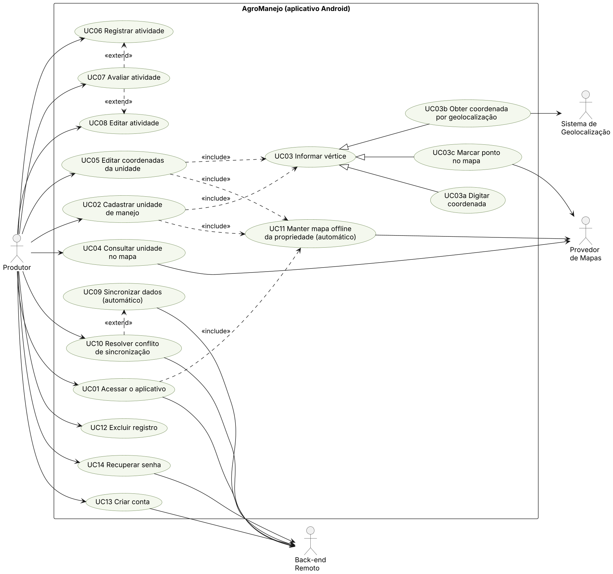
:::

## 3.2 Lista de casos de uso

| Caso de uso | Ator principal | Descrição | Requisitos |
|---|---|---|---|
| UC01 Acessar o aplicativo | Produtor | Entrar com a conta e, quando quiser, sair. No primeiro acesso, o aplicativo baixa os dados e o mapa da propriedade. | RF13, RF16 |
| UC02 Cadastrar unidade de manejo | Produtor | Nomear a unidade, escolher o uso, informar os vértices e salvar o polígono validado com sua área. | RF01, RF05, RF06, RF19 |
| UC03 Informar vértice | Produtor | Acrescentar uma coordenada ao contorno, por uma das três formas abaixo. | RF01 |
| UC03a Digitar coordenada | Produtor | Digitar latitude e longitude. | RF02 |
| UC03b Obter coordenada por geolocalização | Produtor | Usar a posição atual do GPS. | RF03 |
| UC03c Marcar ponto no mapa | Produtor | Tocar no mapa para criar o vértice. | RF04 |
| UC04 Consultar unidade no mapa | Produtor | Ver a propriedade no mapa e abrir uma unidade com sua área e suas atividades, ou consultar a agenda de atividades. | RF07, RF12, RF19 |
| UC05 Editar coordenadas da unidade | Produtor | Incluir, mover ou remover vértices, mantendo o mínimo de 3, e alterar nome e uso. | RF10, RF19 |
| UC06 Registrar atividade | Produtor | Planejar uma atividade com os dados de planejamento da seção 1.5. | RF08 |
| UC07 Avaliar atividade | Produtor | Marcar a atividade concluída como positiva ou negativa, com observações. | RF09 |
| UC08 Editar atividade | Produtor | Alterar qualquer dado de uma atividade, inclusive registrar a execução. | RF11, RF18 |
| UC09 Sincronizar dados | (automático) | Enviar alterações pendentes e receber atualizações do servidor. | RF14, RF15 |
| UC10 Resolver conflito de sincronização | Produtor | Escolher qual versão de um registro em conflito deve ser mantida. Exige conexão. | RF15 |
| UC11 Manter mapa offline da propriedade | (automático) | Baixar e atualizar no aparelho o pacote de mapa da região da propriedade. | RF16, RNF04 |
| UC12 Excluir registro | Produtor | Excluir uma unidade (com as suas atividades) ou uma atividade, após confirmação. | RF17 |
| UC13 Criar conta | Produtor | Cadastrar nome, e-mail e senha e confirmar o e-mail. Exige conexão. | RF13 |
| UC14 Recuperar senha | Produtor | Receber por e-mail um link para definir nova senha. Exige conexão. | RF13 |

## 3.3 Especificação dos casos de uso principais

**UC01 Acessar o aplicativo**

- **Fluxo principal:**
  1. O produtor informa e-mail e senha.
  2. O aplicativo autentica o produtor no back-end e guarda a sessão no aparelho.
  3. No primeiro acesso nesse aparelho, o aplicativo baixa todos os dados do produtor (UC09) e o pacote de mapa da propriedade (UC11), exibindo o progresso.
- **Acessos seguintes:** o aplicativo abre com a sessão guardada, mesmo sem conexão.
- **Fluxo alternativo, sair:** em Mais → Conta, o produtor escolhe "Sair". O aplicativo tenta sincronizar (UC09). Se restarem alterações não enviadas, avisa quantas são e que serão perdidas, e oferece "Cancelar" (opção destacada) ou "Sair mesmo assim". Ao sair, a sessão e o banco local do aparelho são apagados.
- **Pós-condição:** a propriedade completa, com dados e mapa, fica disponível no aparelho.

**UC13 Criar conta e UC14 Recuperar senha**

- **Pré-condição:** há conexão.
- **UC13, fluxo principal:**
  1. Na tela de acesso, o produtor escolhe "Criar conta" e informa nome, e-mail e senha.
  2. O aplicativo cria a conta no serviço de autenticação do back-end, que envia um e-mail de confirmação.
  3. O produtor confirma o e-mail pelo link recebido.
  4. O servidor cria o registro do produtor e a sua propriedade, e o produtor segue para o UC01.
- **UC13, fluxo alternativo, e-mail já cadastrado:** o aplicativo informa e oferece a recuperação de senha (UC14).
- **UC14, fluxo principal:** o produtor escolhe "Esqueci a senha" e informa o e-mail; o back-end envia um link para definir uma nova senha; depois, o produtor entra normalmente (UC01).

**UC02 Cadastrar unidade de manejo**

- **Pré-condição:** produtor identificado (UC01). Não é necessária conexão.
- **Fluxo principal:**
  1. No mapa, o produtor escolhe "Nova unidade" e informa o nome e o uso.
  2. O produtor informa um vértice (UC03), por uma das três formas.
  3. O aplicativo desenha o contorno parcial e atualiza a área em tempo real.
  4. Os passos 2 e 3 se repetem até haver pelo menos 3 vértices.
  5. O produtor toca em "Concluir".
  6. O aplicativo valida o polígono (seção 2.3) e calcula a área final em hectares.
  7. O aplicativo salva a unidade no banco local, marcada como pendente de sincronização.
  8. O aplicativo exibe a unidade no mapa da propriedade.
  9. Se a unidade estiver fora da região já baixada e houver conexão, o aplicativo baixa o pacote de mapa da nova região (UC11).
- **Fluxo alternativo, polígono inválido (passo 6):** o aplicativo destaca o problema no mapa, e o produtor corrige os vértices antes de salvar.
- **Fluxo alternativo, GPS indisponível ou com baixa precisão (UC03b):** o aplicativo avisa e oferece as outras duas formas de entrada.
- **Pós-condição:** a unidade fica salva no aparelho e será enviada ao servidor na próxima sincronização.

**UC05 Editar coordenadas da unidade**

Segue os passos 2 a 9 do UC02 sobre uma unidade existente. Na edição, o produtor também pode arrastar ou remover vértices. O polígono é validado novamente e a área é recalculada.

**UC06 Registrar atividade, UC08 Editar atividade e UC07 Avaliar atividade**

- **Pré-condição:** a unidade de manejo existe e não está excluída.
- **Fluxo principal, planejamento (UC06):**
  1. O produtor toca na unidade, no mapa ou na lista, e escolhe "Nova atividade".
  2. O produtor seleciona o tipo e informa a descrição, a data prevista (opcional) e o tempo estimado.
  3. O produtor informa, um por um, os custos de mão de obra, de insumos e de maquinário. O aplicativo mostra o custo operacional total.
  4. O produtor informa a receita esperada.
  5. O aplicativo valida os campos e salva a atividade localmente, com a situação Planejada e marcada como pendente de sincronização.
- **Fluxo principal, execução (UC08):**
  1. O produtor abre a atividade, pela unidade ou pela agenda, e muda a situação para Em andamento ou Concluída.
  2. Ao concluir, o produtor informa a data realizada. O aplicativo pré-preenche os custos e a receita realizados com os valores previstos, e o produtor ajusta o que mudou.
  3. O aplicativo valida e salva a atividade localmente, como pendente.
- **Fluxo alternativo, data realizada ausente (passo 2):** o aplicativo não conclui a atividade e destaca o campo.
- **Avaliação (UC07):** liberada quando a atividade está concluída, no registro ou depois. O produtor escolhe positiva ou negativa e, se quiser, escreve observações.

**UC12 Excluir registro**

- **Pré-condição:** a unidade ou a atividade existe. Não é necessária conexão.
- **Fluxo principal:**
  1. O produtor escolhe "Excluir" no painel da unidade ou na atividade.
  2. O aplicativo pede confirmação. Para uma unidade, informa quantas atividades também serão excluídas.
  3. O aplicativo marca o registro como excluído e pendente, e deixa de exibi-lo. Para uma unidade, também deixa de exibir as suas atividades.
  4. A exclusão é enviada ao servidor na próxima sincronização (UC09), como qualquer alteração. Ao aceitar a exclusão de uma unidade, o servidor exclui as atividades dela, e essas exclusões chegam aos aparelhos pelo recebimento.
- **Fluxo alternativo, registro alterado em outro aparelho:** se o registro foi editado em outro aparelho antes de a exclusão chegar ao servidor, há conflito (UC10). O produtor vê a versão editada e decide entre manter a exclusão ou adotar a edição.
- **Pós-condição:** o registro não aparece mais em nenhum aparelho do produtor. Não há opção de desfazer nesta versão.

**UC09 Sincronizar dados**

- **Gatilho:** o aparelho recupera a conexão, ou o aplicativo é aberto com conexão disponível.
- **Fluxo principal:**
  1. O aplicativo envia ao back-end os registros pendentes.
  2. O aplicativo marca como sincronizados os registros aceitos.
  3. O aplicativo recebe as alterações feitas pelo mesmo produtor em outros aparelhos e as grava localmente. Registros em conflito não são sobrescritos.
- **Fluxo alternativo, conflito (passo 1):** se o registro foi alterado em outro aparelho desde a última sincronização, o servidor recusa a gravação e mantém a sua versão. No aparelho, a versão local é preservada e marcada como em conflito. As duas versões continuam existindo, uma em cada lugar, até a decisão do produtor (UC10).

**UC10 Resolver conflito de sincronização**

- **Pré-condição:** existe um registro em conflito e há conexão.
- **Fluxo principal:**
  1. O produtor abre o registro em conflito.
  2. O aplicativo busca no servidor a versão atual e exibe as duas versões lado a lado.
  3. O produtor escolhe manter a sua versão ou adotar a do servidor.
  4. Antes de enviar a escolha, o aplicativo consulta de novo a versão do servidor.
  5. Se ela não mudou e o produtor escolheu a própria versão, o aplicativo a envia informando a versão de origem. O servidor só grava se a versão ainda for a mesma.
  6. Se o produtor adotou a versão do servidor, ela substitui a cópia local.
- **Fluxo alternativo, servidor alterado novamente (passos 4 e 5):** se a versão do servidor mudou depois da exibição, nada é gravado. O registro continua em conflito, e as versões atualizadas são exibidas para nova decisão.
- **Pós-condição:** nenhuma versão é sobrescrita sem que o produtor tenha visto a versão que está sendo substituída.

**UC11 Manter mapa offline da propriedade**

- **Gatilhos:** primeiro acesso (UC01), unidade criada ou alterada (UC02, UC05) e reconexão após uma unidade ter sido criada fora da região baixada.
- **Fluxo principal:**
  1. O aplicativo calcula a região da propriedade: o retângulo que envolve todas as unidades, com margem.
  2. O aplicativo verifica se essa região já está no aparelho.
  3. Se não estiver, baixa o pacote de mapa da região nos níveis de zoom definidos, usando Wi-Fi ou dados móveis.
- **Fluxo alternativo, sem conexão:** o download fica pendente e é feito automaticamente quando a conexão voltar.

# 4. Diagrama de classes

O diagrama de classes é apresentado em duas visões complementares do mesmo modelo, para manter a legibilidade: a visão de domínio (Figura 2a) e a visão de interface e serviços (Figura 2b). Na Figura 2b, as classes de domínio aparecem de forma resumida.

- **Domínio** (Figura 2a):
  - Produtor possui Propriedade, e cada Propriedade contém várias UnidadeManejo.
  - Cada unidade tem um uso (UsoUnidade) e é composta por três ou mais Vertice, em ordem (o contorno), e por zero ou mais Atividade.
  - A área em hectares (/areaHectares) e os custos operacionais total previsto (/custoOperacional) e realizado (/custoOperacionalRealizado) são atributos derivados: a área é calculada a partir dos vértices, e cada custo é a soma dos três itens correspondentes.
  - TipoAtividade define as categorias de atividade, e SituacaoExecucao, o andamento (planejada, em andamento ou concluída). A operação concluir() exige a data realizada, e avaliar() só é aceita em atividade concluída; a avaliação é opcional ([0..1]).
  - UnidadeManejo e Atividade implementam a interface RegistroSincronizavel, que reúne os dados de controle da sincronização: identificador, versão do servidor, versão-base da edição local, situação (pendente, sincronizado, em conflito ou rejeitado), identificador da operação pendente, motivo de rejeição e a data de exclusão lógica (excluidoEm). Os vértices são sincronizados junto com a sua unidade.
- **Interface** (Figura 2b): as telas TelaAcesso (entrar, criar conta e recuperar senha), TelaUnidade (o mapa), TelaAtividade, TelaAgenda (aba Atividades) e TelaMais (sincronização, pacotes de mapa e conta). TelaUnidade e TelaAtividade também exibem os conflitos de sincronização.
- **Serviços** (Figura 2b):
  - ServicoLocalizacao fornece a posição atual e acompanha o produtor enquanto o mapa está aberto.
  - ServicoMapaOffline baixa, guarda e carrega os pacotes de mapa da propriedade.
  - CalculadoraGeografica valida o polígono e calcula a área.
  - RepositorioLocal grava e lê os dados no SQLite, inclusive o cursor de recebimento e as marcações de conflito e rejeição.
  - ServicoSincronizacao coordena a troca de dados com o back-end e a resolução de conflitos, por meio do ClienteBackend (Supabase). O envio devolve um ResultadoEnvio por registro: aceito, conflito ou rejeitado.
  - PacoteMapa descreve cada pacote de mapa guardado no aparelho (região, níveis de zoom, tamanho e data).

::: {.diagrama .retrato}
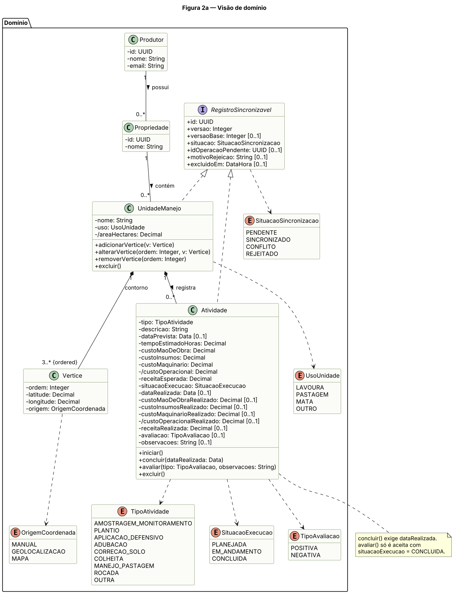
:::

::: {.diagrama .girado}
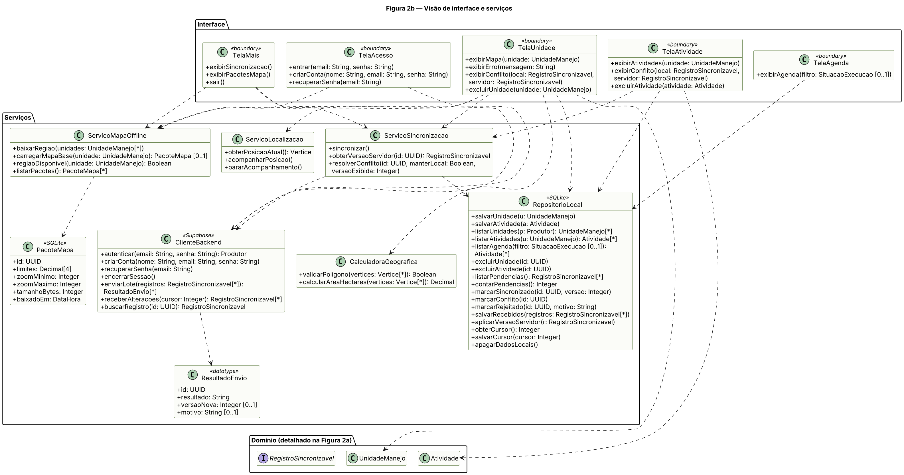
:::

# 5. Diagramas de sequência

Os diagramas a seguir representam os fluxos principais. Os participantes são os mesmos do diagrama de classes.

## 5.1 Cadastrar unidade de manejo (UC02 e UC03)

O fragmento alt dentro do laço mostra as três formas de informar cada vértice (Figura 3). A unidade é salva primeiro no banco local. Em seguida, o aplicativo solicita, de forma assíncrona, a sincronização e o download do mapa da região, que só ocorrem se houver conexão. A edição de coordenadas (UC05) segue o mesmo fluxo.

::: {.diagrama .girado}
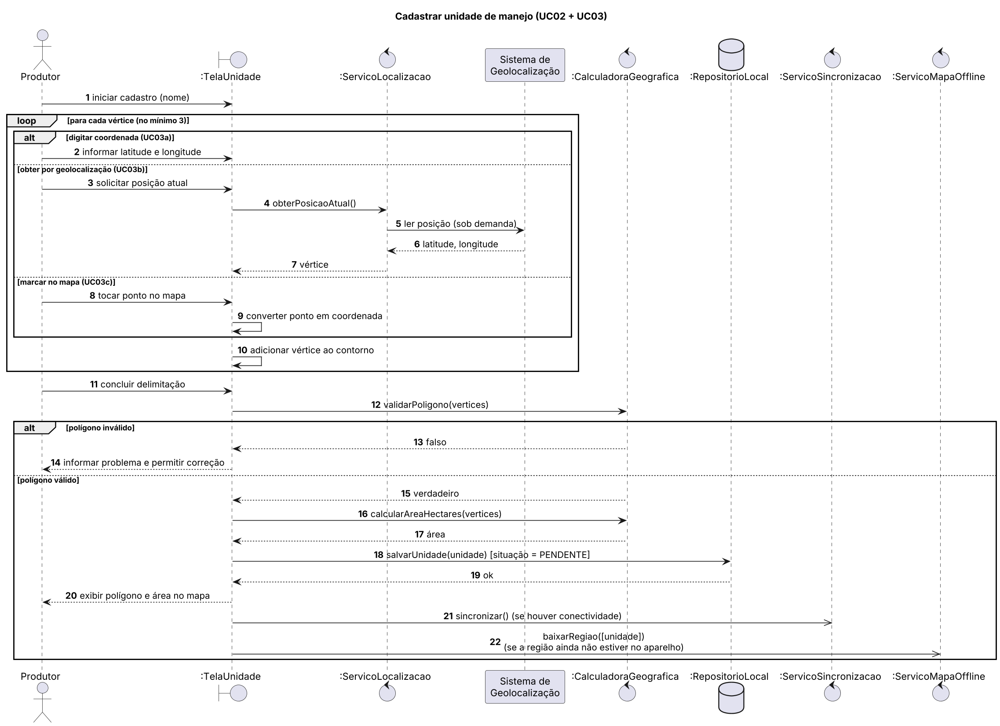
:::

## 5.2 Consultar unidade no mapa (UC04)

O mapa de fundo vem do pacote armazenado no aparelho (Figura 4). Se a região ainda não estiver no aparelho, o aplicativo a baixa quando há conexão; sem conexão, desenha as unidades sobre um fundo neutro. A posição do produtor é acompanhada enquanto o mapa está aberto e deixa de ser lida quando ele sai da tela.

::: {.diagrama .retrato}
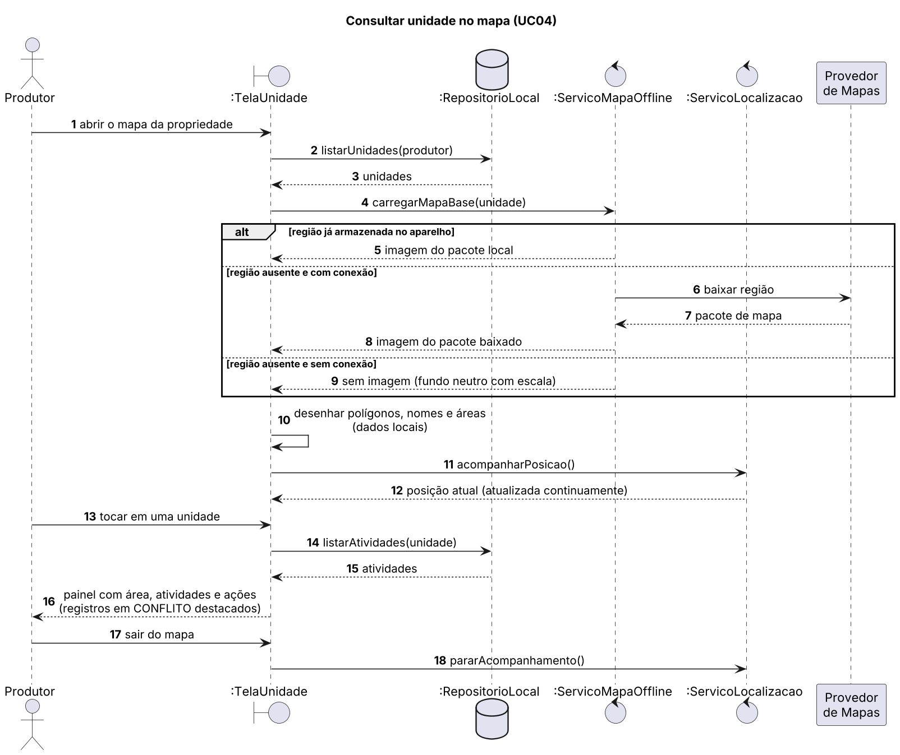
:::

## 5.3 Planejar, executar e avaliar atividade (UC06, UC08 e UC07)

A Figura 5 mostra o ciclo da atividade em três etapas. No planejamento, os dados são informados um por um, o aplicativo calcula o custo operacional total e salva a atividade como planejada. Na execução, o produtor conclui a atividade com a data realizada, e os valores realizados chegam pré-preenchidos com os previstos. A avaliação só é aceita depois da conclusão. Cada etapa grava localmente, marca o registro como pendente e solicita a sincronização.

A exclusão (UC12) não tem diagrama próprio: ela grava a data de exclusão no registro e segue o mesmo fluxo de gravação local e sincronização das Figuras 3, 5 e 6. A criação de conta e a recuperação de senha (UC13 e UC14) usam os fluxos padrão do serviço de autenticação, descritos na seção 3.3.

::: {.diagrama .retrato}
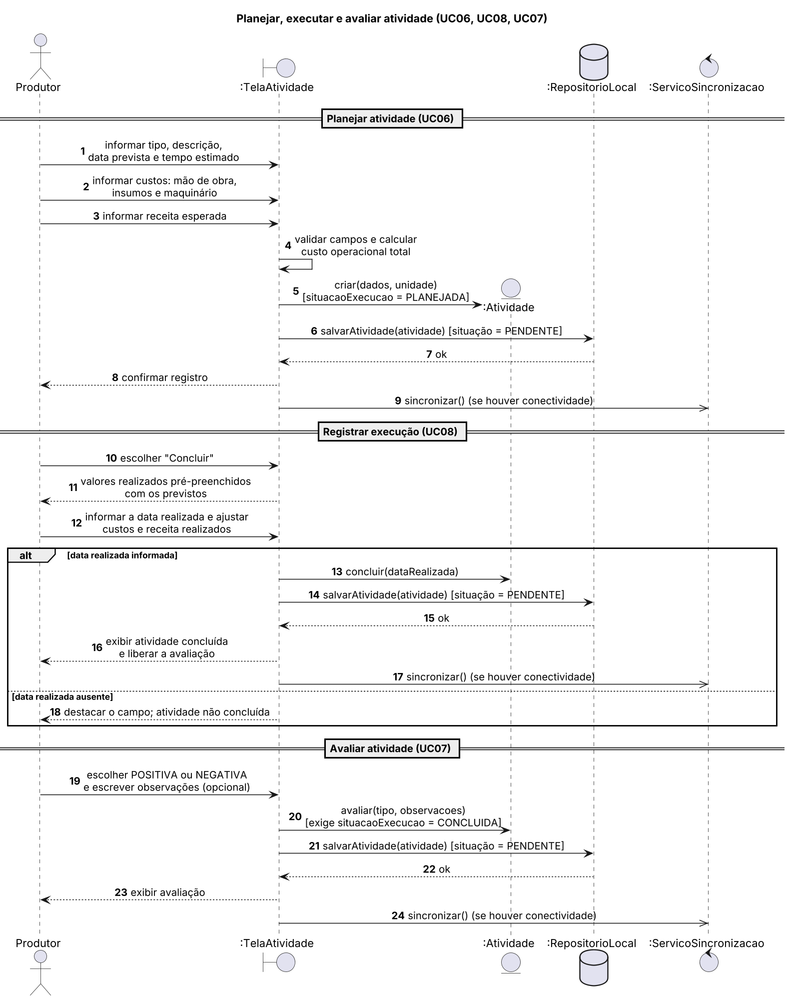
:::

## 5.4 Sincronizar dados (UC09)

O aplicativo envia as pendências e depois recebe as alterações do servidor (Figura 6). O envio passa por uma função do banco que grava cada registro numa transação, e reenvios não duplicam dados. O servidor aceita um registro somente se a versão de origem corresponder à versão que ele armazena; se não corresponder, há conflito e a cópia local é preservada; se os dados forem inválidos, o registro é rejeitado com o motivo. O recebimento é paginado a partir de um cursor e entrega apenas alterações de transações já concluídas, para que nenhuma alteração seja pulada. Registros pendentes ou em conflito não são sobrescritos. O protocolo completo está na especificação técnica 01 (pasta especificacoes).

::: {.diagrama .retrato}
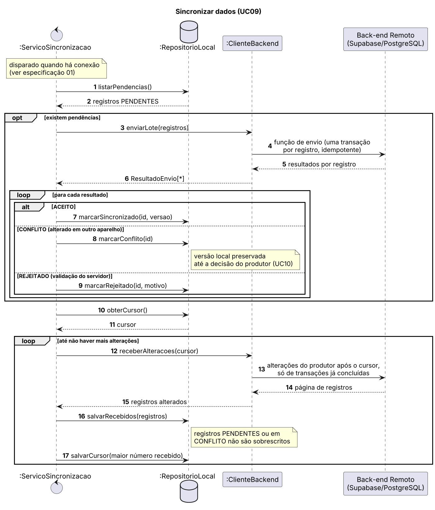
:::

## 5.5 Resolver conflito de sincronização (UC10)

A versão do servidor é consultada duas vezes (Figura 7): para exibição (passos 2 a 8) e de novo antes de qualquer gravação (passos 11 e 12). Se ela mudou nesse intervalo, ou se mudar entre a verificação e o envio, nada é gravado e o conflito é exibido novamente.

::: {.diagrama .retrato}
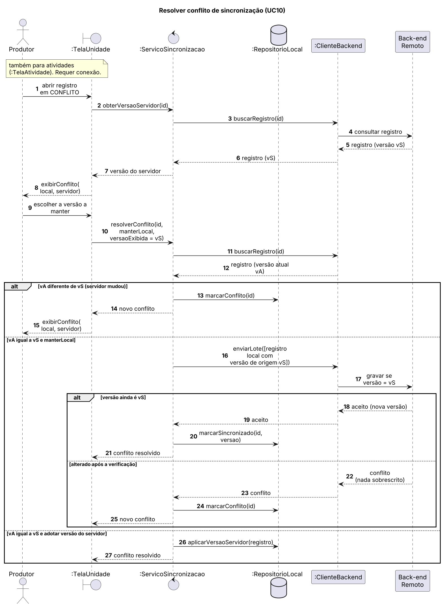
:::

# 6. Modelo Entidade-Relacionamento

O modelo de dados do servidor é apresentado em duas figuras: as entidades do negócio (Figura 8a) e as tabelas de apoio à sincronização (Figura 8b).

**Entidades do negócio:**

| Entidade | Descrição |
|---|---|
| PRODUTOR | Usuário do aplicativo. O id é o mesmo da conta de autenticação. |
| PROPRIEDADE | Imóvel rural do produtor, que reúne as unidades de manejo. Criada pelo servidor junto com a conta. |
| UNIDADE_MANEJO | Área de manejo de uma propriedade, com nome, uso (LAVOURA, PASTAGEM, MATA ou OUTRO) e área calculada em hectares. |
| VERTICE | Coordenada do contorno, com ordem (sequência no polígono) e origem (MANUAL, GEOLOCALIZACAO ou MAPA). |
| ATIVIDADE | Atividade de uma unidade, com tipo, descrição, data prevista, tempo estimado, os três custos previstos, receita esperada, situação da execução, data realizada, custos e receita realizados, avaliação opcional e observações. |

**Tabelas de apoio à sincronização:**

| Tabela | Descrição |
|---|---|
| REGISTRO_ALTERACAO | Uma linha por gravação aceita, com número sequencial e identificador da transação. Permite ao aparelho receber as alterações a partir de um cursor sem pular nenhuma. |
| OPERACAO_PROCESSADA | Identificadores das operações de envio já processadas e seus resultados. Garante que um reenvio não grave os dados duas vezes. |
| CONFIGURACAO_APP | Parâmetros do servidor, como a versão mínima do aplicativo aceita na sincronização. |

Regras do modelo:

- Cada propriedade pertence a um produtor, e cada unidade pertence a uma propriedade. Cada vértice e cada atividade pertencem a uma unidade.
- UNIDADE_MANEJO, VERTICE e ATIVIDADE também guardam o produtor_id, repetido da propriedade, para que as regras de acesso e as consultas de sincronização filtrem diretamente pelo dono.
- UNIDADE_MANEJO e ATIVIDADE têm excluido_em (exclusão lógica). Quando a exclusão de uma unidade é aceita, o servidor exclui na mesma transação as atividades dela que ainda estiverem ativas. Uma atividade nova ou alterada numa unidade excluída é rejeitada.
- A avaliação só é aceita com situacao_execucao igual a CONCLUIDA, e essa situação exige data_realizada.
- tipo da atividade: AMOSTRAGEM_MONITORAMENTO, PLANTIO, APLICACAO_DEFENSIVO, ADUBACAO, CORRECAO_SOLO, COLHEITA, MANEJO_PASTAGEM, ROCADA ou OUTRA.
- Todas as tabelas registram criado_em, definido pelo servidor.
- A área (area_hectares) é recalculada pelo servidor com o PostGIS a cada gravação aceita e passa a ser o valor oficial; o valor calculado no aparelho é provisório até a sincronização.
- O par (unidade_id, ordem) é único.
- O mínimo de três vértices por unidade é garantido pelo aplicativo na validação do polígono.
- O custo operacional total não é armazenado: é calculado a partir de custo_mao_de_obra, custo_insumos e custo_maquinario.
- Os atributos versao e atualizado_em são controlados pelo servidor e apoiam a sincronização.
- O custo operacional total realizado também não é armazenado: é calculado a partir dos três custos realizados.
- Tipos e precisão: latitude e longitude com 6 casas decimais (cerca de 0,1 m); valores monetários, previstos e realizados, com 2 casas decimais e nunca negativos; tempo em horas com 2 casas decimais; datas prevista e realizada sem horário.
- Índices em produtor_id em todas as tabelas do negócio, em propriedade_id nas unidades, em (unidade_id, ordem) nos vértices e em (produtor_id, numero) no registro de alterações.

**No aparelho (SQLite)**, as entidades do negócio têm a mesma estrutura. A PROPRIEDADE é recebida do servidor e não é editada no aparelho nesta versão. As demais diferenças são três:

- valores monetários guardados em centavos, como números inteiros, para evitar erros de arredondamento;
- UNIDADE_MANEJO e ATIVIDADE acrescentam os dados de controle da sincronização: situacao (pendente, sincronizado, em conflito ou rejeitado), versao_base, id_operacao_pendente e motivo_rejeicao;
- tabelas somente locais: META_SINCRONIZACAO (cursor de recebimento e último ciclo concluído), PACOTE_MAPA (pacotes de mapa baixados) e REGISTRO_DIAGNOSTICO (falhas de sincronização, sem dados pessoais).

Os arquivos de imagem dos pacotes de mapa são gerenciados pela biblioteca de mapas no armazenamento do aparelho. O detalhamento completo está na especificação técnica 03.

::: {.diagrama .girado}
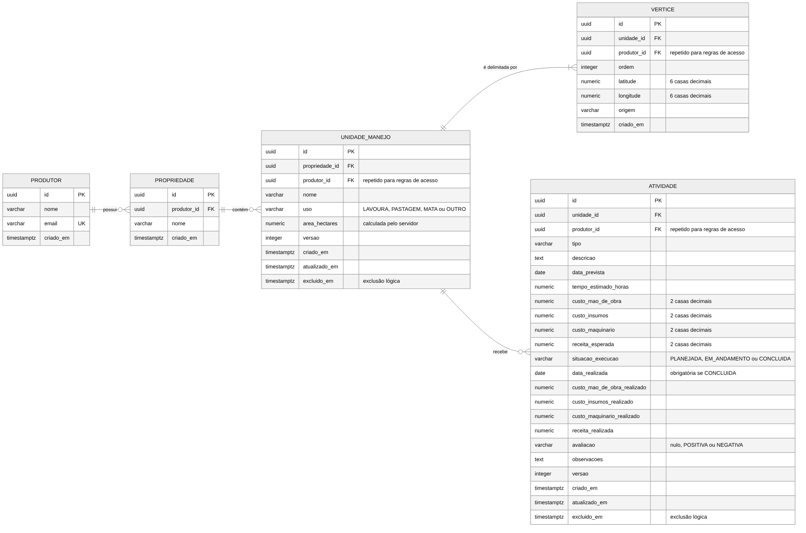
:::

::: {.diagrama .retrato}
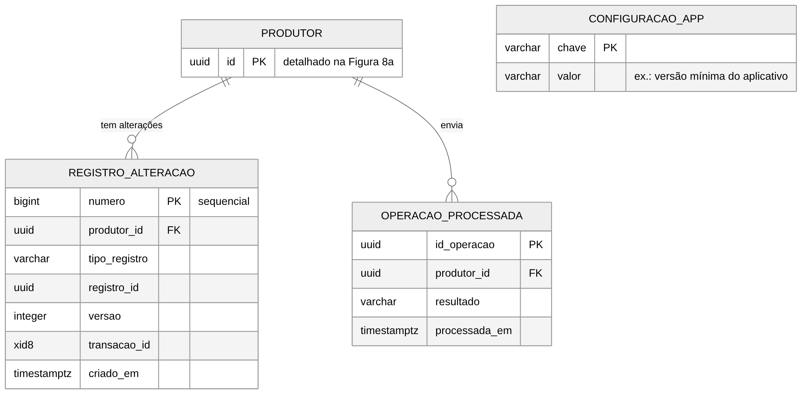
:::

# 7. Relatório técnico

## 7.1 Arquitetura da solução

A solução segue o modelo offline-first: o aplicativo lê e grava sempre no armazenamento do aparelho — o banco SQLite para os dados e os pacotes de mapa para as imagens. A comunicação com o servidor acontece em segundo plano, apenas quando há conexão. Assim, a propriedade inteira fica disponível no campo, e o servidor centraliza os dados de todos os usuários.

::: {.diagrama .girado}
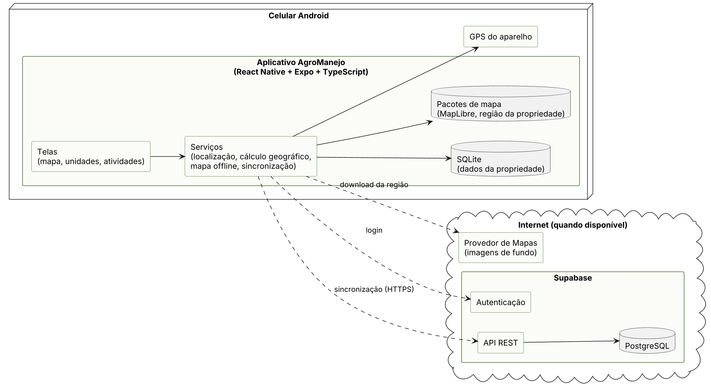
:::

## 7.2 Plataforma: Android com React Native, Expo e TypeScript

A plataforma escolhida é Android, para concentrar o desenvolvimento e os testes em um único sistema. O aplicativo é desenvolvido com React Native, Expo e TypeScript.

| Alternativa | Vantagens | Desvantagens para este projeto |
|---|---|---|
| **React Native + Expo + TypeScript (escolhida)** | Bibliotecas maduras para mapa com pacotes offline (MapLibre), GPS (expo-location) e banco local (expo-sqlite). TypeScript detecta erros de tipo durante o desenvolvimento. Ampla documentação e comunidade. | Camada adicional entre o código e o sistema Android. |
| Android nativo (Kotlin) | Máximo desempenho e acesso direto aos recursos do sistema. | Curva de aprendizado maior e ciclo de desenvolvimento mais lento. |
| Flutter (Dart) | Bom desempenho e interface consistente. | Exige uma linguagem específica, menos difundida. |
| Ionic/Capacitor (tecnologias web) | Aproveita conhecimento de desenvolvimento web. | Desempenho inferior em telas com mapas e interações intensas. |

O React Native gera componentes de interface nativos do Android e mantém produtividade e facilidade de manutenção, o que atende à usabilidade (RNF03) e à eficiência (RNF05).

Para o mapa offline, a escolha é a biblioteca MapLibre React Native. O seu módulo OfflineManager baixa e armazena pacotes de mapa de uma região delimitada, em níveis de zoom definidos. A biblioteca não roda no aplicativo Expo Go, então o desenvolvimento usa um *development build* próprio, recurso suportado pelo Expo. Os pacotes de mapa são servidos pelo próprio projeto, porque os provedores comerciais avaliados não permitem o armazenamento offline por tempo indeterminado. Nesta fase, a camada de referência (estradas, rios e nomes) é gerada a partir do OpenStreetMap para o Rio Grande do Sul, e a imagem de satélite é o mosaico Sentinel-2 cloudless da EOX, cuja licença permite o uso não comercial. A análise dos provedores e a estratégia de pacotes estão na especificação técnica 02.

Na versão atual do Expo (SDK 58), o Android mínimo suportado é o 7.0. A versão mínima final será confirmada no início da implementação.

## 7.3 Banco de dados: SQLite local e Supabase/PostgreSQL remoto

A solução usa dois bancos, cada um com uma função:

- **SQLite (no aparelho).** Banco relacional embutido no Android, acessado pela biblioteca expo-sqlite. Guarda todos os dados do produtor e garante o funcionamento offline (RF14, RNF04).
- **Supabase com PostgreSQL (no servidor).** Serviço gerenciado que reúne quatro recursos usados pelo projeto:
  - um banco PostgreSQL relacional, que corresponde diretamente ao Modelo ER;
  - **autenticação** de usuários (RF13);
  - uma API REST gerada automaticamente;
  - **regras de acesso por linha**, que garantem que cada produtor veja apenas os próprios dados (RNF07).

  A extensão PostGIS oferece funções geográficas, como o cálculo de área sobre o elipsoide (ST_Area com o tipo geography), útil para conferir no servidor a área calculada no aparelho.

| Alternativa | Por que não foi escolhida |
|---|---|
| Firebase (Firestore) | Tem sincronização offline embutida, mas é um banco não relacional: não corresponde ao Modelo ER e oferece poucos recursos geográficos para polígonos. |
| MySQL ou PostgreSQL com API própria | Exigiria construir e manter servidor, autenticação e API. É trabalho maior, sem ganho para a proposta. |

O SQLite e o Supabase não se sincronizam sozinhos. A sincronização é uma responsabilidade do próprio aplicativo, descrita a seguir.

## 7.4 Disponibilidade offline e sincronização

Disponibilidade da propriedade. O aplicativo prioriza ter a propriedade sempre acessível, ainda que isso consuma mais recursos:

- todos os dados do produtor ficam permanentemente no aparelho, sem limpeza automática;
- o pacote de mapa da região da propriedade é baixado automaticamente e atualizado quando unidades são criadas ou alteradas, por Wi-Fi ou por dados móveis;
- a posição do produtor é acompanhada continuamente enquanto o mapa está aberto.

O custo dessa escolha é maior ocupação de armazenamento (os pacotes de mapa podem chegar a dezenas ou centenas de megabytes, conforme o tamanho da propriedade e o nível de detalhe), maior consumo de dados móveis nos downloads e maior uso de bateria com o mapa aberto.

Sincronização. O mecanismo segue padrões consolidados de aplicativos offline-first:

1. **Gravação local primeiro.** Toda alteração é salva no SQLite e marcada como *pendente*. O produtor nunca espera pela rede.
2. **Identificadores únicos.** Cada registro recebe um identificador universal (UUID) criado no próprio aparelho. Isso evita duplicação quando dados são criados em aparelhos diferentes ou reenviados após uma falha.
3. **Disparo automático.** Quando o aparelho recupera a conexão, o aplicativo envia as pendências em lote e depois recebe as alterações feitas pelo mesmo produtor em outros aparelhos.
4. **Controle de versões pelo servidor.** Cada registro tem um número de versão atribuído pelo servidor. O relógio do celular não é usado para decidir qual alteração é a mais recente, pois pode estar errado.
5. **Conflitos e rejeições sem perda silenciosa.** Se um registro foi alterado em dois aparelhos, o servidor mantém a sua versão e o aparelho mantém a versão local, marcada como *em conflito*. Alterações recebidas depois não sobrescrevem esse registro. O produtor vê as duas versões e escolhe qual manter (UC10). Antes de gravar a escolha, o aplicativo consulta de novo a versão do servidor, e o servidor só aceita a gravação se a versão não tiver mudado. Registros recusados pela validação do servidor ficam marcados como *rejeitados*, com o motivo exibido ao produtor.
6. **Falhas de rede.** Envios que falham são repetidos automaticamente, com intervalos crescentes entre as tentativas, sem duplicar registros (graças aos identificadores únicos).
7. **Recebimento sem lacunas.** O aparelho recebe as alterações a partir de um cursor, e o servidor só entrega alterações de transações já concluídas, para que nenhuma seja pulada quando muitos usuários gravam ao mesmo tempo.
8. **Exclusão como alteração.** Excluir é gravar a data de exclusão no registro. A exclusão segue o mesmo caminho das demais alterações, com versão e detecção de conflito: se o registro foi editado em outro aparelho, o produtor decide entre a exclusão e a edição.
9. **Saída sem perda silenciosa.** Ao sair da conta, o aplicativo tenta enviar as pendências e, se não conseguir, avisa antes de apagar os dados locais.
10. **Evolução do esquema.** As estruturas do banco local e do servidor são versionadas por migrações. O aplicativo informa sua versão ao sincronizar, e o servidor recusa versões incompatíveis, pedindo atualização em vez de gravar dados num formato errado.

## 7.5 Segurança e privacidade

- **Comunicação:** toda troca de dados com o servidor usa HTTPS.
- **Credenciais:** a sessão do produtor fica no armazenamento seguro do aparelho (expo-secure-store, que no Android cifra os valores com o Android Keystore). A senha não é guardada.
- **Dados no aparelho:** o banco SQLite é criptografado com SQLCipher, recurso suportado pelo expo-sqlite. A chave do banco fica no armazenamento seguro. Isso protege dados financeiros e de localização em caso de perda ou roubo do celular.
- **Dados no servidor:** regras de acesso por linha no PostgreSQL garantem que cada produtor leia e grave apenas os próprios registros, mesmo que alguém tente acessar a API diretamente.
- **Validação no servidor:** o servidor não confia apenas no aplicativo. Ele valida de novo o polígono (com as funções geográficas do PostGIS), os campos obrigatórios e os valores não negativos antes de gravar.
- **LGPD:** a permissão de localização é pedida apenas para uso com o aplicativo aberto, e os dados pessoais limitam-se ao necessário (nome, e-mail e coordenadas das unidades). A exclusão da conta e dos dados pode ser atendida no servidor mediante solicitação.
- **Recuperação:** o servidor é a cópia de segurança dos dados. Em caso de perda do aparelho, basta entrar com a conta em outro celular para recuperar a propriedade; apenas alterações ainda não sincronizadas se perdem.

## 7.6 Como a solução atende às necessidades

| Necessidade | Como a solução atende |
|---|---|
| Unidades definidas por 3 ou mais coordenadas, informadas manualmente, pelo GPS ou no mapa | UC02 e UC03, com as três especializações. Barra de ferramentas do mapa (seção 1.4). Classe Vertice com atributo origem. |
| Delimitação do polígono e cálculo da área | Seção 2.3. CalculadoraGeografica valida o polígono e calcula a área geográfica, também em tempo real durante o desenho. |
| Visualização da propriedade no mapa | UC04 e seção 1.4. Camadas de imagem, unidades, vértices e posição do produtor. |
| Registro de atividades com dados detalhados | UC06 e seção 1.5. Custos registrados item a item e total calculado. Entidade ATIVIDADE. |
| Planejamento e acompanhamento da execução | UC06 e UC08, aba Atividades (agenda). Data prevista, situação, data e valores realizados ao lado dos previstos. |
| Avaliação positiva ou negativa, com observações | UC07, liberada após a conclusão. Atributos avaliacao e observacoes. |
| Edição de contornos e atividades a qualquer momento | UC05 e UC08, disponíveis também offline. |
| Correção de cadastros feitos por engano | UC12: exclusão lógica, sincronizada entre aparelhos, com confirmação. |
| Lavoura e pastagem na mesma propriedade | Uso da unidade (RF19), com cor no mapa, e tipos de atividade de pastagem. |
| Propriedade sempre disponível, mesmo sem internet | Dados completos no SQLite e mapa da região em pacotes offline (UC11, seção 7.4). |
| Sincronização com servidor central | Supabase/PostgreSQL, UC09 e UC10. Conflitos resolvidos pelo produtor, sem perda silenciosa. |
| Interface simples para uso no campo | Mapa como tela central, três formas de entrada de vértices, área em tempo real e erros destacados no próprio mapa. |
| Segurança e privacidade | Seção 7.5: HTTPS, sessão no armazenamento seguro, banco local criptografado, regras de acesso por linha e validação no servidor. |
| Uso eficiente de recursos | Envio somente das pendências, em lote. Nenhuma tentativa de rede sem conexão. GPS desligado fora da tela do mapa. Mapa baixado só para a região da propriedade e só quando ela muda. |
| Escalabilidade com muitos usuários simultâneos | Back-end gerenciado com capacidade ampliável conforme a demanda. Dados separados por produtor, com índices. O modelo offline-first reduz requisições ao servidor. Réplicas e múltiplas regiões ficam previstas como evolução. |

## 7.7 Validação prevista e próximos passos

Metas iniciais de qualidade, a confirmar com o protótipo:

| Aspecto | Meta |
|---|---|
| Disponibilidade offline | O mapa da propriedade, com unidades e atividades, abre em modo avião em até 3 segundos. |
| Sincronização | Começa em até 60 segundos após a conexão voltar, sem ação do produtor. |
| Integridade | Nenhuma alteração perdida nos testes de conflito entre dois aparelhos. |
| Cálculo de área | Diferença de no máximo 0,5% em relação à área calculada pelo PostGIS para os mesmos vértices. |
| Captura por GPS | Aviso ao produtor sempre que a precisão informada for pior que 10 m. |

Na fase de prototipação, o aplicativo será validado em cinco etapas:

1. testes em celular Android físico, com o *development build* do aplicativo;
2. testes complementares no emulador Android;
3. testes automatizados da lógica, especialmente da validação do polígono, do cálculo da área e do cálculo do custo total, comparando os resultados com valores de referência;
4. testes de funcionamento offline, incluindo o mapa da propriedade em modo avião, e de persistência e sincronização, incluindo conflito entre aparelhos;
5. teste final do aplicativo instalado por arquivo APK.

A implementação do protótipo é organizada em seis fases, nesta ordem. As datas serão definidas no início da implementação.

| Fase | Conteúdo | Duração relativa |
|---|---|---|
| 1. Esqueleto | Projeto Expo com *development build*, SQLite criptografado, entrada e criação de conta no Supabase, mapa online com o desenho de um polígono salvo no aparelho. | Curta |
| 2. Unidades | As três formas de informar vértices, validação do polígono, área em tempo real, uso da unidade, edição e exclusão. | Média |
| 3. Atividades | Planejamento, execução, avaliação e a aba Atividades (agenda). | Média |
| 4. Sincronização | Funções de envio e recebimento no servidor, regras de acesso por linha, indicador de sincronização e resolução de conflitos (UC10). | Longa |
| 5. Mapa offline | Geração e hospedagem dos pacotes, grupos de unidades, download no aparelho e gestão de espaço. | Média |
| 6. Testes e APK | As cinco etapas de validação descritas acima. | Média |

A sincronização vem antes do mapa offline porque é a parte com maior risco de perda de dados e de mudança no esquema do banco. O mapa offline é mais isolado e pode ser acrescentado depois sem afetar os dados.

Limitações reconhecidas:

- O primeiro acesso exige internet, para autenticar o produtor e baixar os dados e o mapa da propriedade.
- Unidades criadas sem conexão numa área ainda não baixada ficam sem imagem de fundo até a conexão voltar.
- Conflitos de sincronização exigem uma decisão do produtor, tomada com conexão.
- Os pacotes de mapa ocupam espaço significativo no aparelho.
- Cada conta corresponde a um produtor. Perfis de equipe (funcionários com acesso à mesma propriedade) não fazem parte desta versão.
- O manejo de rebanho não faz parte desta versão. A pastagem é tratada pelas unidades e atividades, sem registro dos animais.
- Exclusões não podem ser desfeitas pelo aplicativo nesta versão.
- A imagem de satélite desta fase tem resolução de 10 m e licença de uso não comercial. Mostra talhões, estradas e mudanças de cultura, mas não detalhes finos como cercas. Um uso comercial exigirá processar o próprio mosaico ou contratar imagem com uso offline permitido (especificação técnica 02).
- Alterações feitas no aparelho e ainda não sincronizadas se perdem se o aparelho for perdido.

Trabalhos futuros:

- **Manejo de rebanho:** animais ou lotes, pesagens, sanidade (vacinas e tratamentos), reprodução e movimentação entre piquetes. Os piquetes já são unidades de manejo com uso Pastagem, de modo que o rebanho se liga ao modelo existente.
- **Perfis de equipe:** funcionários, agrônomos e veterinários com acesso a uma propriedade, com permissões por papel. A entidade PROPRIEDADE já existe para isso: os membros da equipe se ligam à propriedade, e as regras de acesso passam a considerar a propriedade, não só o produtor.

- **Importação de contornos prontos**, para criar unidades de manejo a partir de arquivos já existentes: KML/KMZ (Google Earth), GeoJSON e shapefiles de cadastros oficiais, como o CAR e o SIGEF/INCRA. Os shapefiles serviriam também como referência do perímetro oficial do imóvel para conferência dos talhões.
- **Imagens próprias de drone** (ortomosaicos) como mapa de fundo de alta resolução, armazenadas no aparelho como as demais imagens.

# 8. Protótipo de telas

Os esboços a seguir mostram as telas principais em baixa fidelidade, para validar a navegação e o conteúdo de cada tela antes da implementação. Cores, ícones e tipografia serão definidos no protótipo.

- **Acesso (Figura 10a):** entrar, criar conta e recuperar senha (UC01, UC13 e UC14).
- **Mapa (Figura 10a):** indicador de sincronização no topo, unidades coloridas pelo uso e painel da unidade tocada (UC04).
- **Desenho da unidade (Figura 10a):** barra com as três formas de informar vértices, área em tempo real, "Desfazer" e "Concluir" (UC02, UC03 e UC05).
- **Atividade (Figura 10b):** planejamento, execução com valores previstos e realizados, e avaliação liberada após a conclusão (UC06, UC07 e UC08).
- **Agenda (Figura 10b):** aba Atividades, por data prevista e com filtro por situação (UC04).
- **Sincronização e conflito (Figura 10b):** lista de pendências, rejeições e conflitos em Mais → Sincronização, e as duas versões de um registro em conflito lado a lado (UC10).

::: {.diagrama .girado}
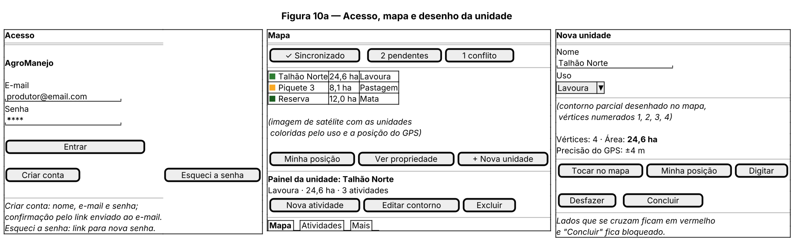
:::

::: {.diagrama .girado}
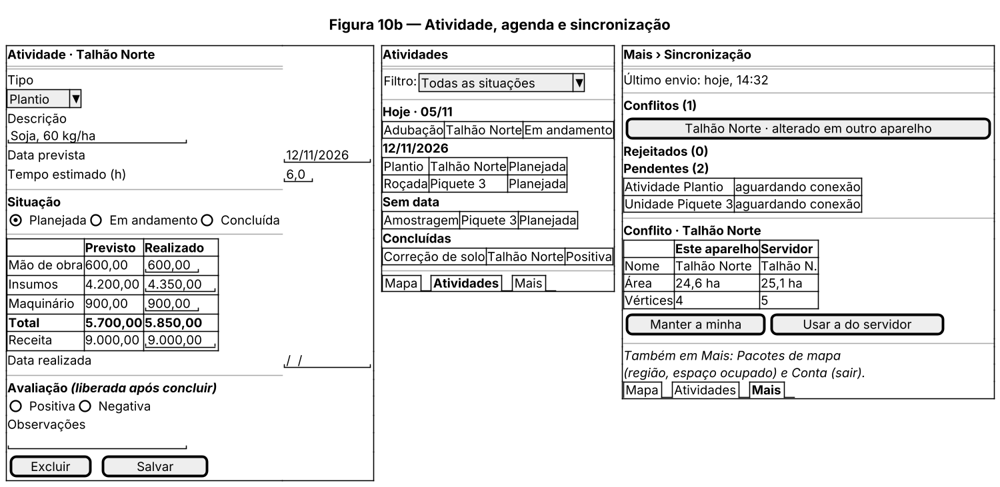
:::

# Referências

- EXPO. *Expo SDK Reference* (expo-sqlite, expo-location). Disponível em: https://docs.expo.dev/versions/latest/. Acesso em: nov. 2026.
- MAPLIBRE. *MapLibre React Native: OfflineManager*. Disponível em: https://maplibre.org/maplibre-react-native/docs/modules/offline-manager. Acesso em: nov. 2026.
- SUPABASE. *Supabase Docs: Auth, Database, PostGIS*. Disponível em: https://supabase.com/docs. Acesso em: nov. 2026.
- POSTGIS. *ST_Area*. Disponível em: https://postgis.net/docs/ST_Area.html. Acesso em: nov. 2026.
- EOX. *EOxCloudless license*. Disponível em: https://cloudless.eox.at/documentation/license. Acesso em: nov. 2026.
- OPENSTREETMAP FOUNDATION. *Tile Usage Policy*. Disponível em: https://operations.osmfoundation.org/policies/tiles/. Acesso em: nov. 2026.
- EL-KASSAS, W. S. et al. Taxonomy of Cross-Platform Mobile Applications Development Approaches. *Ain Shams Engineering Journal*, 2015.
